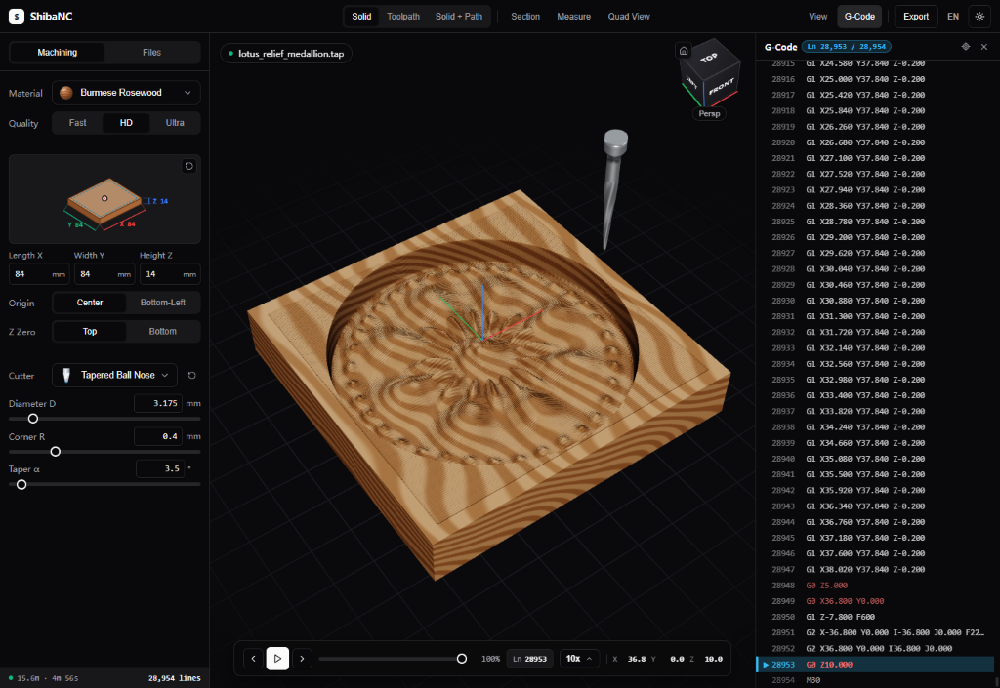
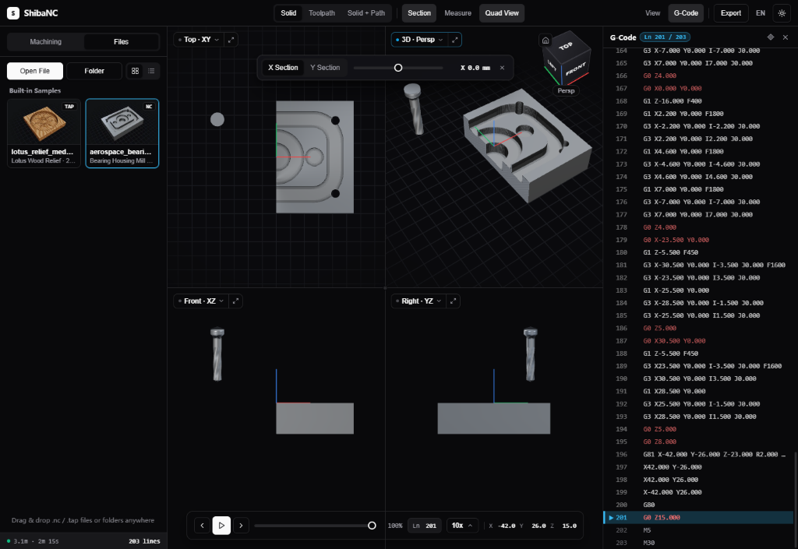
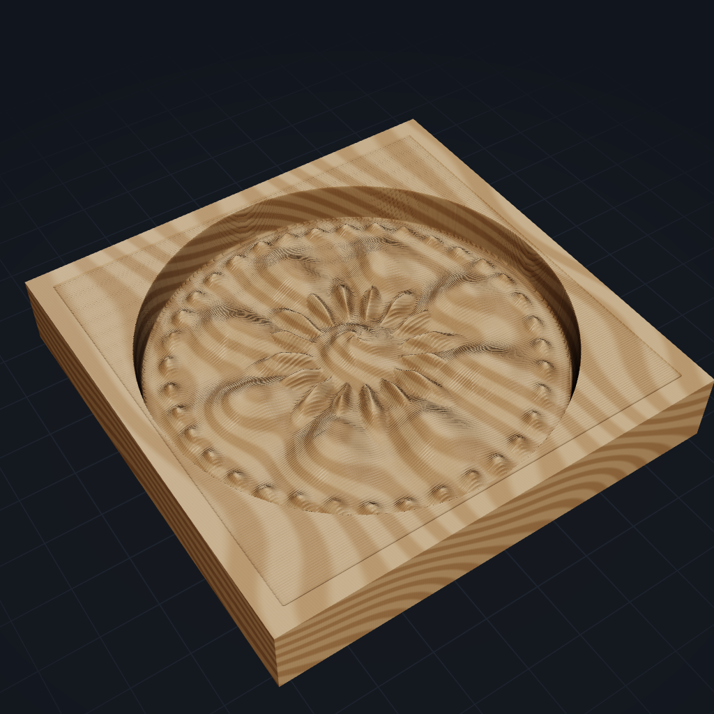
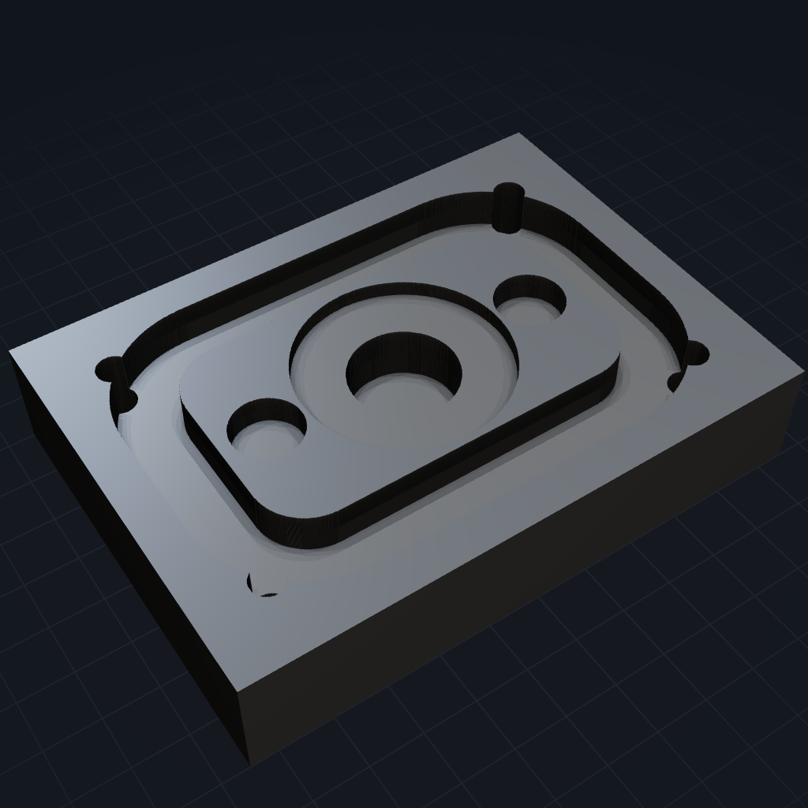

<div align="center">

# ShibaNC

**High-Definition 3-Axis CNC G-Code Toolpath & Material-Removal Simulation Studio**

**English** · [简体中文](./README.zh-CN.md)

[](./Cargo.toml)
[](./shaders)
[](./app)
[](./LICENSE)

</div>

<p align="center">
  
</p>

**ShibaNC** is a cross-platform 3-axis CNC visualization and solid verification studio built with **Rust**, **`wgpu` (WGSL Compute)**, and **Tauri v2**. Both the interactive desktop viewport and native OS file explorer thumbnails share the exact same GPU heightfield simulation and studio-lit material shaders—turning raw `.tap`, `.nc`, `.gcode`, and `.cnc` files into crisp, inspectable 3D machined parts in milliseconds.

---

## Key Features

- **Zero-Copy G-Code Streaming (`shibanc-gcode`)**
  - Memory-mapped (`memmap2`) parser handling million-line relief `.tap` and milling `.nc` programs with automatic UTF-8 / GBK comment decoding.
  - Full support for `G0/G1/G2/G3` (`IJK` and `R` arcs interpolated at `≤ 0.012 mm` chordal tolerance), `G17/G18/G19` planes, `G20/G21` units, `G90/G91` distance modes, and `G81/G82/G83` canned drilling cycles.
  - **3-Tier Stock & Cutter Auto-Inference**: Extracts CAM header metadata (Fusion 360, Mastercam, PowerMill, SurfMill, ArtCAM) or geometrically deduces stock bounds and cutter profiles (`Flat`, `Ball Nose`, `Tapered Ball Nose`, `Bull Nose`, `V-Bit`) from stepover and Z-relief curvature.

- **Sub-Micron GPU Material-Removal Engine (`shaders/` + `shibanc-render`)**
  - Parallel `atomicMin` WGSL compute heightfield at `0.1 μm` fixed-point Z precision with incremental slice updates for zero-drop scrubbing and playback.
  - **Adaptive Microscope ROI Resampling**: Zooming into fine carvings (`≥ 2.25×`) dynamically dispatches a localized sub-viewport compute patch down to micrometer precision.
  - **Studio Shading & 4× MSAA**: Crease-aware surface normals keep 90° end-mill walls razor-sharp while smoothing ball-nose scallops, paired with multi-scale horizon ambient occlusion across 6 presets (*Natural Pine*, *Burmese Rosewood*, *6061 Aluminum*, *H62 Brass*, *Celadon Jade*, and *Z-Depth Elevation Heatmap* with `1 mm` contour lines).
  - Automatic multi-core `rayon` CPU fallback for headless or GPU-restricted environments.

- **CAD Inspection & Multi-Viewport Workflow (`app/`)**
  - **Blender-Style Multi-View (`Q` / `Ctrl+Alt+Q`)**: Single-pass GPU split rendering across Single, Split, and Quad (`Top · XY`, `Front · XZ`, `Right · YZ`, `3D`) viewports with draggable splitters.
  - **Live 3D Cross-Section & Surface Measurement**: Real-time `X/Y` section planes with 45° CAD-hatched solid walls, plus 3D surface ray-picking for cut-depth probing and point-to-point `ΔX / ΔY / ΔZ` dimensioning.
  - **Interactive Orthographic ViewCube**: 6 cardinal faces and 8 isometric corner vertices for instant orthographic/perspective projection switching.
  - **Demand-Driven Rendering (`0%` Idle GPU)**: Redraws strictly on camera, parameter, timeline, or resize events.

- **OS File Explorer 3D Thumbnails & CAD Mesh Export**
  - Native 3D file icons for `.tap`, `.nc`, `.gcode`, and `.cnc` on **Windows** (`IThumbnailProvider` COM DLL in `HKCU`, no admin rights required), **macOS** (`QLThumbnailProvider`), and **Linux** (Freedesktop thumbnailer).
  - Export **1920×1440 4× MSAA PNG** renders or **watertight binary `.STL` meshes** directly from the UI or CLI.

- **Bilingual UI & Custom JSON Language Packs**
  - Built-in **English** (default) and **Simplified Chinese (`简体中文`)**, plus one-click `.json` language pack import and export for community translations.

---

## Visual Showcase

| Quad-Viewport, Live 3D Section & Card Previews | Chinese Studio Interface (`简体中文`) |
| :---: | :---: |
|  |  |

| Offscreen CLI Render — Lotus Wood Relief (`.tap`) | Offscreen CLI Render — 6061 Bearing Housing (`.nc`) |
| :---: | :---: |
|  |  |

---

## Workspace Architecture

```text
ShibaNC/
├── crates/
│   ├── shibanc-gcode/      # Zero-copy G-code parser, arc interpolator & stock/tool inference
│   ├── shibanc-render/     # Headless wgpu simulation, 4x MSAA studio renderer, rayon fallback & STL exporter
│   ├── shibanc-cli/        # CLI for PNG rendering, watertight STL export & OS thumbnail registration
│   ├── shibanc-thumb-win/  # Windows Explorer IThumbnailProvider COM shell extension (.dll)
│   └── shibanc-ffi/        # C FFI static library for macOS QuickLook integration
├── shaders/
│   ├── sim_3axis.wgsl      # Parallel 3-axis cutter swept-envelope compute shader
│   ├── studio_part.wgsl    # Crease-aware normals, horizon AO, procedural materials & CAD section shader
│   └── toolpath.wgsl       # G0/G1 toolpath, WCS triad & 3D cutter assembly shader
├── macos-quicklook/        # Swift QLThumbnailProvider extension for macOS Finder
└── app/                    # Tauri v2 + React + TypeScript + pure WebGPU desktop & web studio
```

---

## Quick Start

### Prerequisites

- **Rust** `1.78+` (`rustup`)
- **Node.js** `18+` & `npm`

### 1. Run Interactive Studio

```bash
cd app
npm install

# Launch WebGPU browser studio (http://127.0.0.1:1420)
npm run dev

# Or launch native Tauri v2 desktop application
npm run tauri dev
```

To build a standalone desktop installer:

```bash
cd app
npm run tauri build
```

### 2. Build CLI & OS File Explorer Thumbnails

```bash
cargo build --release -p shibanc-cli -p shibanc-thumb-win
```

Generate sample CNC programs, render offscreen studio PNGs, or export a watertight binary `.STL` mesh:

```powershell
# Generate built-in relief (.tap) and mechanical (.nc) samples
.\target\release\shibanc-cli.exe generate-samples -d samples

# Render 1024x1024 studio PNG previews
.\target\release\shibanc-cli.exe thumb -i samples\lotus_relief_medallion.tap -o preview_lotus.png -s 1024
.\target\release\shibanc-cli.exe thumb -i samples\aerospace_bearing_housing.nc -o preview_bearing.png -s 1024

# Export machined workpiece as a watertight binary STL mesh
.\target\release\shibanc-cli.exe export-stl -i samples\aerospace_bearing_housing.nc -o housing.stl -g 512
```

Enable or disable native Windows Explorer 3D thumbnails (current user `HKCU`, no administrator privileges needed):

```powershell
.\target\release\shibanc-cli.exe register-thumbnails
.\target\release\shibanc-cli.exe unregister-thumbnails
```

On Linux (GNOME Files / KDE Dolphin):

```bash
./target/release/shibanc-cli install-linux-thumbnailer
```

---

## Keyboard Shortcuts

| Key | Action |
| :--- | :--- |
| `Space` / `K` | Play / Pause toolpath simulation |
| `←` / `→` | Step 1 segment (paused) · Hold to scrub · Seek `±5%` (while playing) |
| `Shift + ←` / `Shift + →` | Jump `±10%` of total toolpath segments |
| `J` / `L` · `,` / `.` | Jump `±5%` · Single-step backward / forward |
| `1` – `6` · `↑` / `↓` | Select playback speed (`1x`, `2x`, `5x`, `10x`, `30x`, `100x`) |
| `Home` (`0`) / `End` | Jump to start (`0%`) or finished part (`100%`) |
| `Q` / `Ctrl + Alt + Q` | Toggle Quad View / Single View |
| `M` | Toggle 3D surface depth & point-to-point measurement |
| `F` | Fit & reset active viewport camera |

---

## Custom Language Packs (Import / Export)

ShibaNC supports user-authored translations via plain `.json` files—no rebuild required:

1. Click the language button (**`EN`**) in the top-right toolbar and choose **Export Language (`.json`)** (or copy [`docs/locale-template.json`](./docs/locale-template.json)).
2. Edit `code`, `name`, `shortLabel`, and translate the string values inside `translations` (keep `{placeholders}` intact; any omitted keys automatically fall back to English):
   ```json
   {
     "format": "shibanc-locale-v1",
     "code": "de",
     "name": "Deutsch",
     "shortLabel": "DE",
     "translations": {
       "topbar.mode.solid": "Volumenkörper",
       "topbar.mode.toolpath": "Werkzeugweg",
       "sidebar.tab.params": "Bearbeitung",
       "sidebar.tab.files": "Dateien"
     }
   }
   ```
3. Click **Import Language (`.json`)** in the language menu to activate and persist your translation immediately.

---

## Automated Releases & In-App Auto-Updates

ShibaNC includes ready-to-use GitHub Actions workflows under [`.github/workflows/`](./.github/workflows):

- **[`ci.yml`](./.github/workflows/ci.yml)**: Runs frontend type-checking/bundling (`tsc && vite build`) and Rust workspace checks/tests (`cargo check` & `cargo test`) on every push and pull request.
- **[`release.yml`](./.github/workflows/release.yml)**: Automatically builds and publishes native installers for **Windows 10/11 (`x64` `.exe` NSIS + `.msi`)**, **Windows 7 SP1 Dedicated Edition (`ShibaNC_*_x64-win7-setup.exe` + `portable.zip`, linked with `YY-Thunks` + WebGL 2.0 3D engine)**, **macOS (`arm64` + `x64` `.dmg`)**, and **Linux (`x64` `.AppImage` + `.deb`)** whenever you push a `v*` tag (or trigger **Run workflow** manually):
  ```bash
  git tag v0.1.0
  git push origin v0.1.0
  ```
- **Version Badge & Auto-Updater**: Click **`v0.1.0`** in the top-left header to check for updates or toggle startup auto-checks.
  - Works out-of-the-box with GitHub Releases (zero secrets required).
  - To enable signed one-click **in-app download, install & restart** (`latest.json`), generate a Tauri signing keypair (`npx tauri signer generate -w ~/.tauri/shibanc.key`) and add `TAURI_SIGNING_PRIVATE_KEY`, `TAURI_SIGNING_PRIVATE_KEY_PASSWORD`, and `TAURI_SIGNING_PUBKEY` to your repository's **Actions Secrets**.

---

## License

Released under the [MIT License](./LICENSE).
