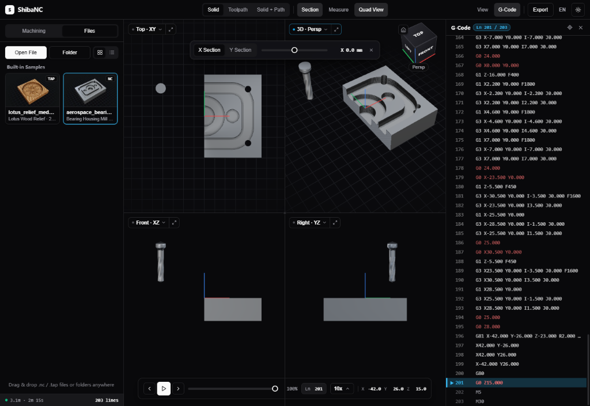
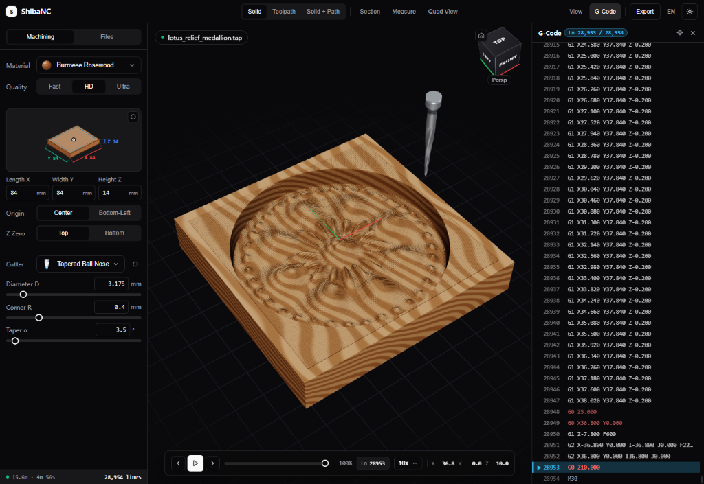
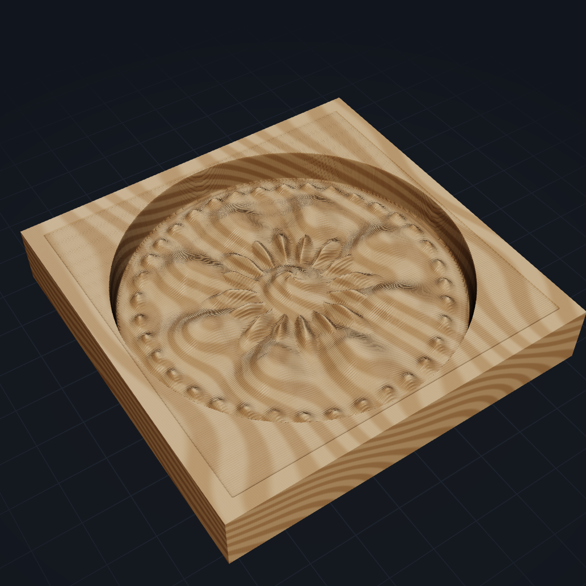
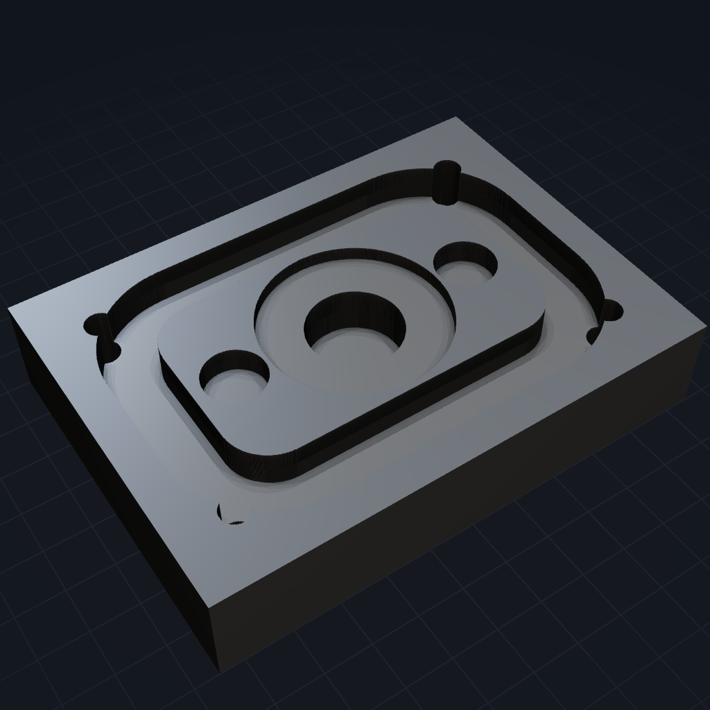

<div align="center">

# ShibaNC

**跨平台三轴 CNC G 代码刀路与高清实体切削仿真工作室**

[English](./README.md) · **简体中文**

[](./Cargo.toml)
[](./shaders)
[](./app)
[](./LICENSE)

</div>

<p align="center">
  
</p>

**ShibaNC** 是一款面向 **三轴 CNC（模具铣削、航空铝零件加工、木工/玉石浮雕 `.tap` / `.nc` / `.gcode` / `.cnc`）** 打造的跨平台刀路验证与材料去除实体预览工具。采用 **Rust + `wgpu` (WGSL Compute) + Tauri v2** 统一架构，交互式主视口与操作系统资源管理器 3D 文件缩略图 **100% 复用同一套 GPU 并行深度场仿真与工作室材质着色器**。

---

## 核心特性

- **零拷贝极速 G 代码解析 (`shibanc-gcode`)**
  - 基于 `memmap2` 内存映射流式解析，百万行精雕 `.tap` 文件毫秒级加载，自动识别 UTF-8 与中文 GBK 后处理注释。
  - 完整支持 `G0/G1/G2/G3`（`IJK` 与 `R` 圆弧 `≤ 0.012 mm` 弦高自适应插补）、`G17/G18/G19` 平面、`G20/G21` 英公制、`G90/G91` 绝对/增量模式以及 `G81/G82/G83` 钻孔固定循环（通孔自动击穿底面透光）。
  - **三级毛坯与刀具智能推断**：优先提取主流 CAM 注释头（Fusion 360、Mastercam、PowerMill、精雕 SurfMill、ArtCAM），无注释时根据行距步距与 Z 向连续曲率自动反推毛坯包络与五类三轴刀型（平底立铣刀、球头铣刀、锥度球头刀、圆鼻铣刀、V 型雕刻刀）。

- **亚微米级 GPU 材料去除仿真与工作室渲染 (`shaders/` + `shibanc-render`)**
  - `0.1 μm` 定点数精度 `atomicMin` WGSL Compute 并行包络切削，正向回放采用**增量切片更新**，百万段刀路实时拖拽零掉帧。
  - **局部自适应显微重采样（Micro ROI）**：视口放大（`≥ 2.25×`）时自动对局部视野执行微米级重采样，清晰还原精雕刀纹细节。
  - **折痕感知法线 + 多尺度环境光遮蔽（Horizon AO）+ 4× MSAA**：立铣 90° 侧壁棱线锐利、球头曲面顺滑，内置 **松木、缅甸花梨木、6061 航空铝、H62 黄铜、翡翠玉石** 及 **1mm 等高线切深云图**。
  - 无 GPU 或受限沙箱环境自动回退至 `rayon` 多核并行 CPU 光栅化器。

- **专业 CAD 剖切检测与多视口工作流 (`app/`)**
  - **Blender 式多视图分屏（`Q` / `Ctrl+Alt+Q`）**：单渲染通道同时驱动单视图、双视图与四视图（`顶视图 XY`、`前视图 XZ`、`右视图 YZ`、`三维视口`），支持拖拽十字分割线自由调节比例。
  - **三维动态剖切与表面点云测量**：支持 `X / Y` 实时动态剖切（45° 机械剖面斜线实体封口），以及模型表面实时切深探针与任意两点三维距离 / `ΔX / ΔY / ΔZ` 高差测量。
  - **正交/透视三维导航立方体（ViewCube）**：支持 6 个主视图面与 8 个等轴测顶点点击切换正交投影，按需渲染引擎在静止时保持 **`0%` 空闲 GPU 占用**。

- **跨平台系统资源管理器 3D 缩略图与 STL 模型导出**
  - 原生支持 **Windows**（`IThumbnailProvider` COM 扩展，当前用户 `HKCU` 免管理员一键注册）、**macOS**（`QLThumbnailProvider`）与 **Linux**（Freedesktop Thumbnailer）文件大图标立体预览。
  - 支持一键导出 **1920×1440 4× MSAA 高清渲染图（`.png`）** 与 **闭合水密二进制 `.STL` 三维网格模型**（可直接用于 CAD 比对或 3D 打印）。

- **中英双语与自定义语言包导入/导出**
  - 内置 **English**（默认）与 **简体中文**，支持一键导出 `.json` 语言模板并导入用户自行翻译的语言包。

---

## 界面与渲染展示

| 四视图分屏、三维动态剖切与 3D 刀路卡片预览 | 英文版主工作台界面 (`English`) |
| :---: | :---: |
|  |  |

| 命令行离屏渲染 — 莲花圆牌浮雕 (`.tap`) | 命令行离屏渲染 — 6061 航空轴承座 (`.nc`) |
| :---: | :---: |
|  |  |

---

## 项目架构

```text
ShibaNC/
├── crates/
│   ├── shibanc-gcode/      # 零拷贝 G 代码字节流解析、圆弧插补与毛坯/刀具几何推断
│   ├── shibanc-render/     # wgpu 离屏切削仿真、4x MSAA 渲染器、rayon CPU 回退与闭合 STL 导出
│   ├── shibanc-cli/        # 命令行工具：高清 PNG 渲染、STL 导出与系统缩略图注册管理
│   ├── shibanc-thumb-win/  # Windows 资源管理器 IThumbnailProvider 原生 COM 缩略图扩展 (.dll)
│   └── shibanc-ffi/        # 供 macOS QuickLook 调用的 C FFI 静态库封装
├── shaders/
│   ├── sim_3axis.wgsl      # 三轴刀具扫掠包络并行深度场 Compute Shader
│   ├── studio_part.wgsl    # 折痕感知法线、Horizon AO、程序化工业材质与剖切面着色器
│   └── toolpath.wgsl       # G0/G1 刀轨、WCS 工件坐标系与三维刀具着色器
├── macos-quicklook/        # macOS Finder QuickLook (QLThumbnailProvider) 扩展
└── app/                    # Tauri v2 + React + TypeScript + 原生 WebGPU 桌面与网页工作台
```

---

## 快速开始

### 环境要求

- **Rust** `1.78+` (`rustup`)
- **Node.js** `18+` 与 `npm`

### 1. 启动交互式工作台

```bash
cd app
npm install

# 启动 WebGPU 浏览器开发预览 (http://127.0.0.1:1420)
npm run dev

# 或启动 Tauri v2 原生桌面客户端
npm run tauri dev
```

打包独立桌面安装程序：

```bash
cd app
npm run tauri build
```

### 2. 编译命令行工具与系统资源管理器 3D 缩略图扩展

```bash
cargo build --release -p shibanc-cli -p shibanc-thumb-win
```

生成内置测试刀路、渲染高清预览图或导出闭合二进制 `.STL` 实体网格：

```powershell
# 生成内置浮雕 (.tap) 与机械铣削 (.nc) 测试刀路
.\target\release\shibanc-cli.exe generate-samples -d samples

# 离屏渲染 1024x1024 工作室级高清 PNG 预览图
.\target\release\shibanc-cli.exe thumb -i samples\lotus_relief_medallion.tap -o preview_lotus.png -s 1024
.\target\release\shibanc-cli.exe thumb -i samples\aerospace_bearing_housing.nc -o preview_bearing.png -s 1024

# 导出水密闭合二进制 STL 三维网格模型
.\target\release\shibanc-cli.exe export-stl -i samples\aerospace_bearing_housing.nc -o housing.stl -g 512
```

一键开启或卸载 Windows 资源管理器 `.tap / .nc / .gcode / .cnc` 三维缩略图（写入 `HKCU`，无需管理员权限）：

```powershell
.\target\release\shibanc-cli.exe register-thumbnails
.\target\release\shibanc-cli.exe unregister-thumbnails
```

Linux 桌面环境（GNOME Files / KDE Dolphin）：

```bash
./target/release/shibanc-cli install-linux-thumbnailer
```

---

## 快捷键一览

| 快捷键 | 功能说明 |
| :--- | :--- |
| `Space` / `K` | 播放 / 暂停切削仿真 |
| `←` / `→` | 暂停时单步进退 1 段 · 长按连续快退/快进 · 播放时快退/快进 `5%` |
| `Shift + ←` / `Shift + →` | 快退 / 快进总行程的 `10%` |
| `J` / `L` · `,` / `.` | 快退 / 快进 `5%` · 单步微调进退 |
| `1` – `6` · `↑` / `↓` | 快速切换回放倍速（`1x`、`2x`、`5x`、`10x`、`30x`、`100x`） |
| `Home` (`0`) / `End` | 跳至加工起点（`0%`）或加工完成实体（`100%`） |
| `Q` / `Ctrl + Alt + Q` | 切换 Blender 四视图 / 单视图 |
| `M` | 开启 / 关闭三维表面切深探针与两点距离测量 |
| `F` | 居中复位当前激活视口相机 |

---

## 自定义语言包（导入 / 导出）

用户无需重新编译即可自行翻译并导入任意语言：

1. 点击顶部工具栏右侧的语言按钮（**`EN` / `中文`**），选择 **导出语言模板 (`.json`)**（或直接复制仓库中的 [`docs/locale-template.json`](./docs/locale-template.json)）。
2. 修改 JSON 中的 `code`、`name`、`shortLabel`，并翻译 `translations` 内的文本（保留 `{变量名}` 占位符，未翻译的词条会自动回退至英文）：
   ```json
   {
     "format": "shibanc-locale-v1",
     "code": "ja",
     "name": "日本語",
     "shortLabel": "JA",
     "translations": {
       "topbar.mode.solid": "ソリッド",
       "topbar.mode.toolpath": "パスのみ",
       "sidebar.tab.params": "加工設定",
       "sidebar.tab.files": "NCファイル"
     }
   }
   ```
3. 在语言菜单中点击 **导入语言包 (`.json`)** 即可立即生效并自动持久化保存。

---

## GitHub Actions 自动打包发布与软件自动更新

仓库内置完整的 CI/CD 工作流（位于 [`.github/workflows/`](./.github/workflows)）：

- **[`ci.yml`](./.github/workflows/ci.yml)**：每次 Push 或 PR 自动执行前端类型检查打包（`tsc && vite build`）与 Rust 全工作区编译测试（`cargo check` & `cargo test`）。
- **[`release.yml`](./.github/workflows/release.yml)**：推送 `v*` 版本标签（或在 GitHub Actions 页面手动点击 **Run workflow**）时，自动并行构建并发布全平台安装包至 GitHub Releases：
  - **Windows 10 / 11 (`x64`)**：`ShibaNC_*_x64-setup.exe`（NSIS 安装包）与 `.msi`（内置 `shibanc_thumb_win.dll` 缩略图扩展）
  - **Windows 7 SP1 专用版 (`x64`)**：`ShibaNC_*_x64-win7-setup.exe` 与免安装绿色包 `ShibaNC_*_x64-win7-portable.zip`（集成 `YY-Thunks` 系统符号兼容层与 WebGL 2.0 三维引擎，兼容车间老旧 Win7 工控机，本地也可通过 `pwsh ./scripts/build-win7.ps1` 独立构建）
  - **macOS (`Apple Silicon` + `Intel`)**：`.dmg` 与 `.app.tar.gz`
  - **Linux (`x64`)**：`.AppImage` 与 `.deb`
  ```bash
  git tag v0.1.0
  git push origin v0.1.0
  ```
- **版本号显示与自动更新**：软件左上角实时显示当前版本号（如 **`v0.1.0`**），点击可打开更新面板，支持**启动时自动检查更新**。
  - **零配置开箱即用**：无需配置密钥即可自动检测 GitHub Releases 最新版本并匹配当前系统安装包下载。
  - **应用内一键静默覆盖更新（可选）**：运行 `npx tauri signer generate -w ~/.tauri/shibanc.key` 生成签名密钥，并在仓库 **Actions Secrets** 中添加 `TAURI_SIGNING_PRIVATE_KEY`、`TAURI_SIGNING_PRIVATE_KEY_PASSWORD` 与 `TAURI_SIGNING_PUBKEY`，Action 将自动生成签名与 `latest.json`，激活客户端内一键下载安装并重启。

---

## 开源许可

本项目基于 [MIT License](./LICENSE) 开源发布。
